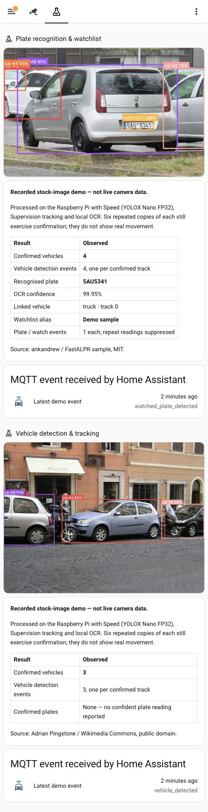
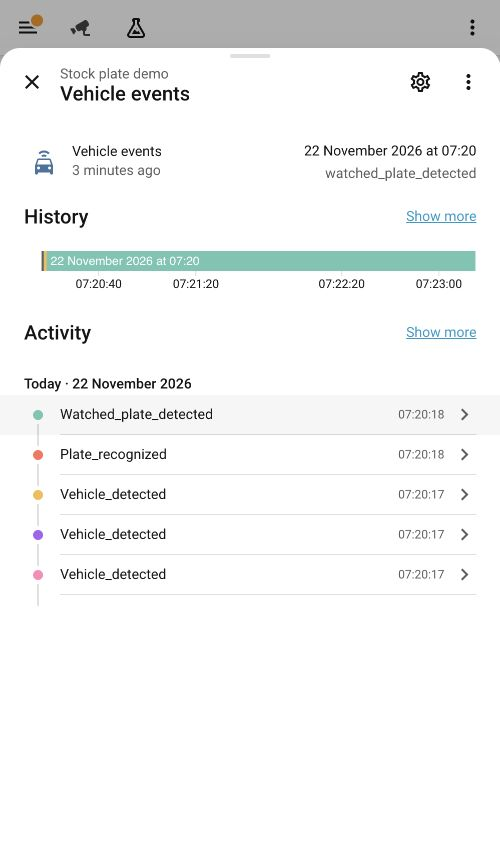

# mqtt-camera-streamer

The goal is simple: make useful camera data available over MQTT with as little
setup, code and as few dependencies as practical, using hardware you already
have. Configure a broker and camera, then run one headless Python process—no
GPU, accelerator or separate inference server required. Keep the core small;
tracking, plate recognition, RTSP and recording build on shared libraries rather
than adding a separate service for each feature.

Turn a USB webcam or RTSP source into Home Assistant detections, vehicle events
and local license-plate recognition. Configure an MQTT broker, choose a camera
and run one headless Python process on available CPU hardware.

| Preset | Model | Purpose |
| --- | --- | --- |
| **Speed** (default) | YOLOX Nano FP32 | Faster detection on a Raspberry Pi |
| **Accuracy** | RF-DETR Nano static INT8 | Higher measured detection accuracy |

[Supervision](https://supervision.roboflow.com/) provides boxes and annotations;
[Roboflow ByteTrack](https://trackers.roboflow.com/develop/trackers/bytetrack/)
confirms and associates tracks, and this project's configurable holds stabilise
presence. [FastALPR](https://github.com/ankandrew/fast-alpr) provides optional local
plate detection/OCR and watched-plate matching.
[Home Assistant's built-in MQTT integration](https://www.home-assistant.io/integrations/mqtt/)
supplies the camera and sensor entities used by dashboards and automations.
The Pi runtime uses **42 locked packages, without PyTorch/TorchVision**;
these features add no new runtime dependency.

Sparse annotated JPEGs over MQTT keep the original simple setup. RTSP and bounded,
file-backed recording are optional. Model preparation stays on a development
computer; the Pi runs ONNX Runtime CPU.

## See it working

Actual Pi inference on public stock images, displayed in Home Assistant. The
stock view is clearly separate from the live webcam: four tracked vehicles and
plate **5AU5341** with an exact watchlist match, plus three vehicles in the Rome
photo. The examples repeat still images to exercise confirmation and suppression.
Nano labels the foreground car as `truck`; that prediction is shown unchanged.



Vehicle, plate and watched-plate events arrive in Home Assistant's native event
entity, once per confirmed track/reading rather than on every frame:



[Reproduce the demo](docs/stock-demo.md) · [Image credits and licenses](examples/images/README.md)

## Quick start with uv

Install [uv](https://docs.astral.sh/uv/getting-started/installation/), then run
from the repository root. Python 3.12 is pinned in `.python-version`. Prepare or
copy the chosen ONNX model using [model setup](docs/models.md).

```sh
uv sync --locked --no-dev
cp config/onnx.yml config/onnx.local.yml
```

Edit `preset: speed` or `preset: accuracy`, camera source, broker host/port and
camera ID in the local file. Verify the
external webcam index rather than assuming it is `0`:

```sh
uv run --locked --no-dev scripts/check-opencv-cameras.py
```

Set `MQTT_USERNAME` and `MQTT_PASSWORD` in the environment when authentication is
required. These are broker credentials, not Home Assistant API tokens. The
[Home Assistant Mosquitto app](https://github.com/home-assistant/app-mosquitto)
requires credentials. Configure Home Assistant's MQTT integration on the same
broker with discovery enabled.

```sh
uv run --locked --no-dev scripts/onnx_camera.py --config config/onnx.local.yml
# Stop after ten predictions for a smoke test:
uv run --locked --no-dev scripts/onnx_camera.py --config config/onnx.local.yml --max-frames 10
```

One device per camera appears in Home Assistant with person/vehicle presence,
count entities and a snapshot camera. Sparse JPEGs over MQTT are the default;
RTSP output and local file-backed recording are optional. Two-frame track confirmation and configurable presence holds
reduce flickering; counts remain instantaneous. Configuration and model files
with local settings/weights are ignored by Git.

## Guides

| Task | Guide |
| --- | --- |
| Headless Raspberry Pi, uv and systemd | [Raspberry Pi deployment](docs/raspberry-pi.md) |
| Configuration, tracking and MQTT discovery | [ONNX and Home Assistant](docs/onnx-home-assistant.md) |
| MQTT snapshots, RTSP, SSH preview and file-backed SQLite | [Images and RTSP](docs/images-and-rtsp.md) |
| Vehicle events, watched plates and automations | [Vehicle events](docs/vehicle-events.md) |
| Pretrained plate detection and OCR | [License plates](docs/license-plates.md) |
| Public-image demo and dashboard configuration | [Stock demo](docs/stock-demo.md) |
| Speed/Accuracy selection and model preparation | [Model presets](docs/models.md) |
| All model and quantization experiments | [Experiment record](docs/experiments/README.md) |
| Dependency reduction and deployment ideas | [Dependencies and performance](docs/dependencies.md) |
| Original MQTT frame-streaming scripts | [Legacy examples](docs/legacy.md) |

## Person present and person left

Tracking lets automations react to changes in presence instead of triggering on
every frame. By default, a person needs two consecutive observations to become a
confirmed track. A configurable hold keeps presence on through brief detection
gaps, reducing flicker and repeated notifications.

For example, merge these settings into your camera configuration:

```yaml
tracking:
  enabled: true
  minimum_consecutive_frames: 2
presence:
  hold_seconds_by_class:
    person: 10
```

Use the discovered person binary sensor in a Home Assistant automation, replacing
the entity ID with your camera's actual ID:

```yaml
alias: Camera person presence changed
triggers:
  - trigger: state
    entity_id: binary_sensor.usb_camera_person_detected
    from: "off"
    to: "on"
    id: present
  - trigger: state
    entity_id: binary_sensor.usb_camera_person_detected
    from: "on"
    to: "off"
    id: left
actions:
  - action: persistent_notification.create
    data:
      title: Camera
      message: "{{ 'Person present' if trigger.id == 'present' else 'Person left' }}"
```

This notifies once when confirmed presence starts, then once when no confirmed
person has been seen for ten seconds (evaluated on the next processed frame).
Another person or a recovered track extends the same presence episode. “Person
left” means no person is currently observed after that hold, not verified physical
departure or identification of a particular person. Camera outages become
`unavailable`; the explicit `on` → `off` trigger does not label them as departures.
MQTT state continues to refresh normally; these notifications come from Home
Assistant state changes, not dedicated person event messages. See
[tracking and hold-time details](docs/onnx-home-assistant.md#tracking-and-presence-hold-times).

## Vehicle events and plates

Cache the pretrained ONNX models, enable `lpr.enabled` in the local configuration,
and run the same service:

```sh
uv run --locked --no-dev scripts/download-plate-models.py --config config/onnx.local.yml
uv run --locked --no-dev scripts/onnx_camera.py --config config/onnx.local.yml
```

Home Assistant automatically discovers the snapshot camera, counts, held presence,
object details, historical plate readings and a vehicle event entity.

| Event | Meaning |
| --- | --- |
| `vehicle_detected` | New confirmed vehicle track |
| `vehicle_lost` | Track no longer observed for the configured timeout |
| `plate_recognized` | Repeated matching OCR confirmed a plate |
| `watched_plate_detected` | Confirmed plate exactly matched a configured alias |

Events are transient MQTT messages under `mqtt_camera/<camera_id>/events`.
Confirmed plates also retain the existing `plate/events` topic and latest `plate`
state. Plate events include confidence, box centre and a vehicle type/track link
when a containing vehicle box is available. Region, make/model, colour and
orientation are not inferred by the current local models.

```yaml
lpr:
  enabled: true
  watched_plates:
    AB12CDE: Family car
images:
  transport: mqtt
  annotate: true
```

Read [event payloads and automation examples](docs/vehicle-events.md). Vehicle loss
is not proof of physical departure; held presence is a separate signal. OCR
consensus, exact watchlist matching and cooldown prevent repeated plate triggers.

## Benchmark

The original preset comparison was measured on a **Raspberry Pi 4
Model B (4 GB)** running 64-bit Debian 13.6, with four ONNX Runtime CPU threads.
They are short tests on a shared machine, not performance guarantees for every
Pi or workload. The reported mAP scores were evaluated separately on the
development computer using a small diagnostic dataset. See the
[comparison table and test conditions](docs/experiments/README.md#latest-matched-comparison).
Separate [Raspberry Pi 3 setup and benchmarks](docs/experiments/pi3.md) record a
1 GB board with active undervoltage/throttling; those power-limited results are
not a promise of performance on other Pi 3 installations.

Use a representative recording to compare machines without opening a webcam or
requiring an MQTT broker:

```sh
uv run --locked --no-dev scripts/benchmark.py --config config/onnx.local.yml \
  --source /path/to/recording.mp4 --warmup 5 --frames 100 \
  --lpr off --output work/benchmark-detection.json
uv run --locked --no-dev scripts/benchmark.py --config config/onnx.local.yml \
  --source /path/to/recording.mp4 --warmup 5 --frames 100 \
  --lpr every-frame --output work/benchmark-plates.json
```

Reports include warm steady-state p50/p95 stage latency, observed pipeline FPS,
model load time, model hash, versions, CPU time and peak process RSS. Pi telemetry
is included when available. This measures capture/decode plus inference and
tracking, with optional plate scans; MQTT, JPEG encoding, recording, RTSP output
and the service's rate-limit sleep are excluded. These results are not model-only FPS or a promise of Pi performance.

## Development

```sh
uv sync --locked
uv run pytest -q
uv run ruff check scripts/onnx_camera.py scripts/onnx_detector.py scripts/yolox_detector.py scripts/plates.py scripts/media.py scripts/vehicle_events.py scripts/demo.py scripts/benchmark.py tests
```

Dependencies live in `pyproject.toml` and `uv.lock`. Use `uv add`, `uv remove` or
`uv lock` to change them and commit the lockfile. `uv sync --locked --no-dev`
prepares a runtime environment; repeat `--no-dev` with `uv run` on that host.
Imutils and Datasette remain opt-in legacy/workstation extras. No web viewer,
screen capture or YouTube download package is required by the runtime.
Install model export extras only when exporting or comparing models; use
`uv sync --locked --no-dev` on the Pi to exclude them and development tools.
RTSP output reuses PyAV (already used by Supervision), with no FFmpeg executable
required; it needs an RTSP server such as the optional standalone MediaMTX binary.

## License

Project code is licensed under the [MIT License](LICENSE). Vendored RF-DETR and
YOLOX helpers retain their Apache-2.0 licenses and notices; stock images retain
their [documented licenses and credits](examples/images/README.md). Dependencies
and pretrained models retain their own licenses. Model provenance and upstream
links are in the plate and dependency guides.
