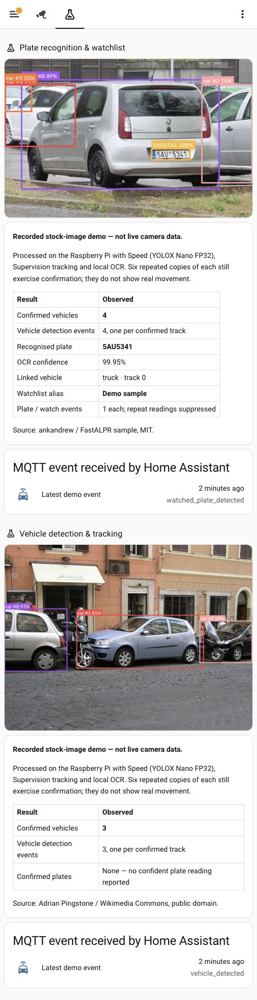
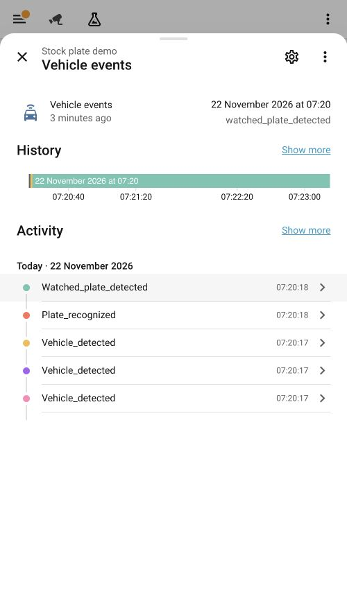

# Reproduce the stock-image demonstration

The repository contains two credited public sample photographs in
[`examples/images`](../examples/images/README.md). No private webcam capture is
used in the README screenshots. Source URLs, licenses and input hashes are kept
in [`sources.json`](../examples/images/sources.json).

Run the same actual ONNX/Roboflow/FastALPR pipeline on six repeated copies of each
still. This demonstrates confirmation, exact watchlist matching and duplicate
suppression; it does not demonstrate movement or real arrivals/departures.

## Run

Prepare a preset model, broker credentials and the normal config as described in
[the README](../README.md). Then:

```sh
uv run --locked --no-dev scripts/demo.py --config config/onnx.local.yml \
  --output work/stock-demo --hold 60
```

The script uses at most two detector/OCR threads, automatically enables local OCR
and tracking for this run, and creates separate `demo_...` camera IDs/devices.
Every prediction/event has `demo: true`. It adds the public sample plate 5AU5341
as alias `Demo sample` only in the copied demo config. Live config, camera process,
storage and watchlist are not changed. The webcam is not opened.

For the deployed Pi, run as the same user with its systemd environment file:

```sh
cd ~/mqtt-camera-streamer
systemd-run --user --unit=mqtt-camera-stock-demo --collect \
  --property=EnvironmentFile="$HOME/.config/mqtt-camera/mqtt.env" \
  --working-directory="$PWD" \
  "$HOME/.local/bin/uv" run --offline --no-sync --no-dev scripts/demo.py \
  --config "$HOME/.config/mqtt-camera/config.yml" --hold 60
journalctl _SYSTEMD_USER_UNIT=mqtt-camera-stock-demo.service -f
```

Use `--images /path/to/first.jpg /path/to/second.jpg` for other inputs. Generated
annotated JPEGs and `results.json` are saved under `--output`. During `--hold`,
results are served as paused, labelled still-image results; timestamps are not
fabricated and detection events are not republished. Normal completion passes a
black input through the detector after the timeout to exercise `vehicle_lost`,
then disconnects the demo devices. Static screenshots/results remain available.

To build the Stock demo tab, copy the generated JPEGs into Home Assistant's
`/config/www/mqtt-camera-demo/`, then use
[`examples/home-assistant-dashboard.yml`](../examples/home-assistant-dashboard.yml)
in a storage dashboard's raw configuration editor. Stock photos are deliberately
served there as static, recorded demo images. Adjust live entity IDs for your
camera. No custom dashboard card or Pi web server is required.

## Observed Pi results, 2026-11-22

| Input | Confirmed vehicles | Confirmed plate | Watch match |
| --- | ---: | --- | --- |
| FastALPR sample | 4 | 5AU5341, 99.95% OCR confidence | Demo sample |
| Rome parking | 3 | None at the configured thresholds | None |

The linked foreground vehicle in the first example is labelled `truck` by Nano;
it is a coarse model prediction and is visibly a classification error. We retain
it rather than substituting a manually chosen label. These two examples are not
an accuracy benchmark; the full [experiment record](experiments/README.md) keeps
labelled quality comparisons and Pi measurements for the two presets.




